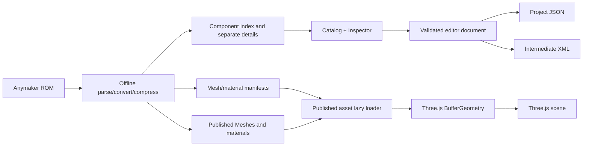

# Anymaker Builder system architecture

## Goals and boundaries

The project is a static frontend whose build output can be deployed directly to GitHub Pages. The production runtime must not depend on a backend, game process, game installation, or user-selected resource files. Component definitions, completely parsed/converted Meshes, materials, textures, and manifests are intended to ship with the static site. Browser file selection remains a development/asset-audit tool only.

There are three product layers:

1. **Editor**: Three.js scene, camera, grids, tools, selection, Inspector, undo/redo.
2. **Published assets**: component definitions, connection surfaces, logic nodes, static/dynamic Meshes, materials, and textures extracted, validated, converted, and compressed offline from Anymaker ROM.
3. **Exchange formats**: browser project JSON and intermediate XML marked `game-compatible="false"`. A game-compatible exporter requires native-save research and game regression evidence first.

## Directory responsibilities

```text
src/
  main.js                 Page composition, events, Three.js scene lifecycle
  assets/
    mesh.js               Anymaker .mesh v5 binary parser
    library.js            Development File objects, parse cache, Three.js geometry
    published/            Planned production manifest, lazy loader, decompression/cache
  editor/
    document.js           Project schema, validation, intermediate XML, history
    model.js              Project/Vehicle/Grid/Component/Node/Edge/Plate/Link and adapters
    operations.js         Pure-data copy/mirror/move/grid split/merge commands
    topology.js           Nodes/beams/plates: creation, split, merge, geometry checks
  components/             Proposed, unimplemented per-component assembly/port/Mesh modules
public/data/
  index.json              Stable index, schema/resourceVersion, Mesh manifest reference
  component-index.json    Lightweight search index
  definitions/            Separate per-component details
  bindings/               Separate per-component Mesh bindings
public/assets/
  manifests/              Published integrity/compression manifests
  meshes/                 One converted asset per original Mesh
  materials/              Textures, materials, compressed products
scripts/
  extract-catalog.mjs     Generate component catalog
  audit-assets.mjs        Scan ROM, validate Mesh, record starter_vehicle.data
doc/                      Architecture, formats, reverse-engineering evidence, designs
tests/
  unit.test.js            Parser, project validation, history, XML tests
  browser/                Playwright workflows under GitHub Pages subpath
```

## Runtime data flow



The component index handles search/resource references, not Three.js runtime objects or huge model payloads. The production `PublishedAssetLoader` is intended to request corresponding assets when components are selected, placed, or visible, check manifest hash/version, then decompress and instantiate. Unused assets should stay out of memory. Local browser `AssetLibrary` is outside the publishing path. These are architecture requirements; hash-field comparison alone is not downloaded-byte verification (see AGENTS).

## Editor state

- `definitions`: definition index keyed by stable `id`.
- `objects`: currently an array of Three.js scene objects; snapshots retain only `id/type/position/rotation/scale`, not render-diagnostic metadata.
- `History`: project snapshots without Three.js references; undo, redo, and branching must copy data.
- `selected` and `tool`: short-lived UI state excluded from project files.
- `PublishedAssetLoader`: published-resource state excluded from project files; saved definition IDs resolve to lazy-loaded assets through bindings/manifests.
- `AssetLibrary`: development/audit state excluded from projects and the complete GitHub Pages user workflow.

## Current domain architecture

`src/editor/model.js` provides Project, Vehicle, Grid, Component, Node, Edge, Plate, Link, and bidirectional editor-document adapters. The scene remains a render projection of domain data. Structural operations create snapshots through `operations.js`; the pure-data model preserves `gridId`, local/parent transforms, units, and unknown-field extras. Native port/beam/plate connections still need `.data` adapter integration at this design stage.

Native samples place nodes/beams/plates at vehicle level; the target model must not force them all into grids. Grid coordinates and render submeshes are also distinct. Native adapters represent game fields; intermediate XML adapters represent a versioned exchange format.

Dependency direction: UI -> commands/domain model -> validation/history. The Three.js scene observes domain changes, resource libraries provide models, and format adapters read/write domain data. Parsers do not reference UI; domain models do not hold Three.js objects.

See [component/resource splitting](04_COMPONENT_MESH_SPLIT.md) for file organization and [building operations](05_BUILD_OPERATIONS.md) for topology.

## Constraints

- Never embed `I:\`, `D:\`, or game EXE paths in production resources.
- Production must not require importing the game directory or local Mesh files. The Pages manifest must cover all promised components and their dynamic/material dependencies.
- Compression optimizes transfer/storage only. Trace every published Mesh to original path/hash, converter version, and quantization/compression parameters; validate geometry/materials before and after compression.
- Do not trust imported JSON components, numbers, IDs, or XML strings. Validate schema, ranges, duplicate IDs, and definition existence first.
- Never call intermediate XML a game save; retain the incompatibility marker in UI and file comments.
- Touch/tablet/mobile layouts are outside this phase; desktop mouse/keyboard browsers are supported.
