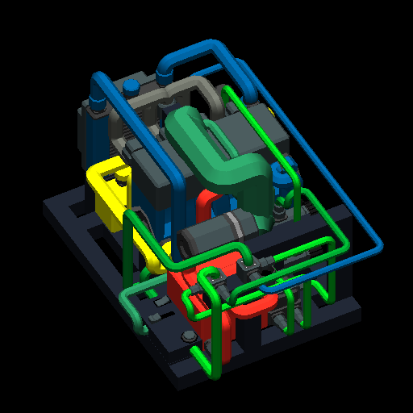

# Pedestal engine and compact inline-four — 14 October

The original task was a gasoline engine on a pedestal, followed by a compact self-contained module retaining fuel tank, battery and controls. These are the accepted starting points for future small-engine integration.

## Pedestal result

The user spawned and ran Petrol_Pedestal_Test_01, supplied a screenshot and overwrote the creation with a running export. That screenshot read 10.1 Hz, 15% throttle, 2.4 kW, 20.7 °C and approximately 3.4 L each of oil and coolant. Its later saved full-throttle state read **133.312954 rps / 7,998.777 RPM**, 25.656768 °C, 3.901881 L engine oil, 4.899925 L engine water and 7.941749 L petrol. Battery retained 99.853% of its initial energy. NO GEARBOX was expected on the standalone stand.

All 60 components, 93 nodes, 119 edges, four panels and six link-family arrays survived game export. Body ID changed 261→214; definitions were reordered and defaults omitted. Compare resolved definition IDs and component IDs, not raw catalog array indexes.

[Original result and limits](archive/toolset/output/pedestal-engine-test-01/LIVE-RESULT.md), [running report](archive/toolset/output/pedestal-engine-test-01/running-result/report.json), [generator](archive/toolset/build_pedestal_engine.py).

## Compact packaging and CPE1Running acceptance

The completed compact layout retained the same 60 components, fitted items, belt reversal settings, fluids and control logic. A connected cradle replaced the broad stand; components and lines were repacked with component-zone occupancy checks and line routing. The final static checks recorded **36 port/fan mounts, five torque mounts, 19 frame contacts and 24 routes**. Adjacent mating faces were deliberate. The static checker reported no overlapping component-zone cells or unrelated component/frame intersections within its supported representation; it did not certify arbitrary mesh clearance.

| Dimension | Width | Length | Height |
| --- | ---: | ---: | ---: |
| Native component bounds | 1.28 m | 0.88 m | 0.80 m |
| Conservative bay envelope including routed lines | **1.36 m** | **1.04 m** | **0.92 m** |

The initial compact file starts RUN off, throttle 15%, starter released, battery charged and liquids filled. RUN, THROTTLE and START occupy the front shelf. Turn RUN on, hold START until it catches, then release. RUN off closes intake throttle. The forward torque face is accessible for the compatible **small gearbox**, which is not included in this module.

The user then tested it successfully and saved it as **CPE1Running**. Read-only comparison confirmed one body and all 60 parts, unchanged placements/orientations, normalized frame geometry and saved connections. Its static audit reported no issues.

| Saved CPE1Running measurement | Value |
| --- | ---: |
| Speed | **135.188261 rps / 8,111.296 RPM** |
| Throttle | 100% |
| Engine temperature | **25.423453 °C** |
| Oil in engine | 3.966045 L |
| Water in engine | 4.979944 L |
| Petrol remaining | 7.945572 L |
| Battery energy fraction | 99.897479% of initial 4 kWh |
| Engine damage factor | 0.000918059 |

Node 70 at the origin re-exported with `pos` omitted. Normalize absent node positions to [0,0,0] when comparing. Body ID became 215; fitted item IDs and optional defaults also changed.

[Fresh compact pair](archive/toolset/output/compact-petrol-engine-01-complete/Compact_Petrol_Engine_01.data), [fresh metadata](archive/toolset/output/compact-petrol-engine-01-complete/Compact_Petrol_Engine_01.meta), [CPE1Running save](archive/toolset/output/compact-petrol-engine-01-complete/running-result/CPE1Running.data), [running metadata](archive/toolset/output/compact-petrol-engine-01-complete/running-result/CPE1Running.meta), [live result](archive/toolset/output/compact-petrol-engine-01-complete/LIVE-RESULT.md), [checks](archive/toolset/output/compact-petrol-engine-01-complete/final-checks.json), [generator](archive/toolset/compact_engine.py).

## Preserve this unresolved question

Both pedestal and compact running saves left the radiator without a saved water quantity and the oil reservoir without oil. All 8.7 L initial water was accounted for in the engine and pump chambers. This establishes redistribution, not stable closed-loop cooling. Small engine damage was nonzero and its cause was not established. No run duration, loaded drivetrain result or alternator charge rate was measured. The later successful giant-engine pump reversal must **not** be copied blindly to this differently routed module. Trace the compact module's actual shaft and port mapping first.

For future vehicle work start from the accepted complete layout, reserve the bay envelope, add a compatible torque path and verify circulation under sustained load without discarding the working engine assembly.
