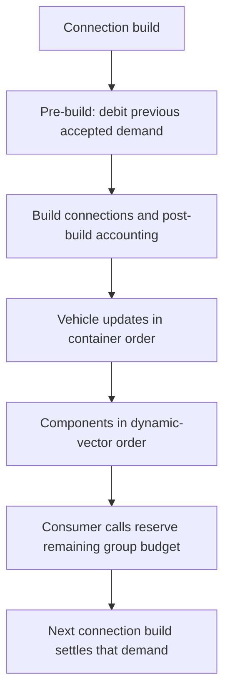

# Electrical ordering, liquid accounting, and script loop limits

Date: 2026-10-19, America/New_York. Continuation requested by the user, using offline analysis without required in-game testing. This report resolves parts of the three questions left by the [first offline reader checkpoint](OFFLINE-20261019.md). Statements marked static concern the reviewed matching-build paths; examples are explanatory calculations, not observations of a running creation.

## Version and evidence

Build 25904830; `bin/game.gcl`, 82,528,301 bytes; SHA-256 `626a994be960b7218409d9ca416d2664450231d1fc3295036fc77c81b8449355`. The installed code still matched the snapshot when research resumed. Decimal offsets below apply only to this file.

Two additional bounded Ghidra batches exported **36 new functions**, checking **7,042 instructions / 38,015 instruction bytes**. The combined local reader now contains 65 functions, 13,855 checked instructions / 77,279 instruction bytes, 660 locally slot-derived call dependencies and 453 unresolved indirect calls. Counts describe tool coverage, not complete understanding or a resolved runtime call graph.

[Selected evidence](versions/build-25904830/offline-systems-20261019/evidence.json) binds 44 function identities (36 new, eight reused), 13 typed constants, four strings, and 20 call-instruction examples. The independent checker re-parsed those identities and verified the selected bytes. [Verification](versions/build-25904830/offline-systems-20261019/verification.json) records tool hashes and actual checks. Full C, assembly, machine facts, and databases remain local.

## Electrical consumers: order and deferred debit

Static trace:

| Reviewed function | Offset | Role |
| --- | --- | --- |
| `vehicle.container.tick` | 52932354 | Runs connection building before iterating vehicle ticks |
| `connections_manager.build` | 44502123 | Registers connections, runs all vehicle pre-build passes, all vehicle build passes, connection-manager builds, then all vehicle post-build passes |
| `vehicle.pre_build` / `post_build` | 53220456 / 53210810 | Dispatches the corresponding electrical and other network passes |
| `vehicle.tick` | 53321058 | In the normal update branch, iterates the dynamic component vector and dispatches component ticks sequentially |
| `vehicle.register_dynamic_component` | 53236485 | Appends eligible components to the vector at vehicle +0x9a0, also used by the tick loop |
| Electrical `consume_binary` / `consume_factor` | 58232976 / 58233735 | Allocates against shared available budget minus pending accepted requests |
| Electrical node-container `pre_build` / `post_build` | 58266905 / 58256785 | Settles previous pending debit, resets accounting, then rebuilds available accounting and redistributes charge |

The reviewed order can be summarized as:



Consumer requests are sequential. There is no proportional sharing between all consumers in these acceptance helpers: a fractional request can take the remaining budget, while a binary request fails if the remaining amount is insufficient. This establishes order sensitivity within a shared group. It does not establish a stable creation-ID, save-file, geometric, or wire-length priority; loading, registration, splits, and other vector mutations need separate tracing before relying on a particular physical component always being first.

For an illustrative group with 10 energy units available, a binary request for 8 followed by a fractional request for 8 accepts 8 and 2. Reversing those requests accepts 8 for the fractional consumer, then zero for the binary consumer, leaving 2 unused. These are amounts for an update, not watt ratings.

At the next electrical pre-build, the code uses `clamp(pending / previous_available, 0, 1)` and subtracts that fraction of each participating source's stored amount. With charges 25 and 75 and accepted demand 20, this debit stage leaves 20 and 60. Source settlement is proportional even though consumer acceptance is sequential. Post-build also performs charge redistribution with a per-content coefficient; the small model below deliberately excludes that additional path, generation, and all efficiency conclusions.

Practical deduction: under limited power, testing a single component can conceal order-sensitive failures in a larger circuit. Designing for adequate total supply is more dependable than treating registration order as a guaranteed priority system. This is a code-based design implication, not a new vehicle test.

## Liquid units, head, and conservation

Static findings:

- `g_litres_per_voxel.$ctor` at 29071100 assigns **0.5**. `vehicle_liquid_content_volume.create` at 58740995 multiplies its calculated geometry quantity by the supplied component factor and this constant when assigning capacity at content +0x28. Use this native conversion for these geometry-created contents; do not replace it with the real-world 0.512 litres implied by an exact 8 cm cube.
- Total liquid quantity is cached at content +0x20; capacity is +0x28; temperature is +0x30. `parse_save_data` at 58737403 rebuilds total quantity by summing the liquid-species entries. `create` at 58718612 assigns capacity.
- `_get_fluid_density` at 58717295 returns coefficient 1.0 for enum value 0 and 0.8 for values 1, 2, and 3. `get_fluid_mass` at 58733303 sums species quantities multiplied by these coefficients. This checkpoint does not recover enum names or prove a universal thermal/physical density table from these four branches.
- `get_fill_factor` at 58732530 clamps quantity/capacity to [0,1] for positive capacity, with separate zero-capacity handling.

There are two distinct pressure-related paths. `vehicle_liquid_content.get_pressure` at 58733956 returns **max(quantity - capacity, 0)**. It is an overfill quantity surrogate, not an independently recovered pressure in pascals.

The broader node network builds a head-like value in `vehicle_liquid_node.container.pre_build` at 58826950: interpolated world-space filled height, plus the node's static-pressure bias, plus a positive overfill contribution. `set_static_pressure` at 58840389 assigns the bias at node +0x28. Thus component-supplied pressure bias, liquid level/orientation, and overfill participate in the network. The pump's chamber-pressure comparison and the network head calculation are different parts of the path.

The post-build implementation at 58812775 sorts connected nodes by their head value and constructs transfers from higher to lower values. A candidate calculation multiplies head difference by **2.0 * 0.01 = 0.02**, then applies source-quantity and destination constraints. No server-delta-time operand appears in that candidate calculation. Treat 0.02 as this native per-build coefficient, not as a universal L/s rating; source/destination interactions, topology, component flags, and update cadence still matter. Full multi-node fairness and all exceptional states remain unfinished.

### Direct transfer and mixture accounting

`vehicle_liquid_content.move_content` at 58735326 computes:

```text
candidate = min(request, source_quantity, destination_capacity - destination_quantity)
if candidate > 0:
    fraction = candidate / source_quantity_before_transfer
    add candidate to destination total; subtract candidate from source total
    for each liquid species:
        moved_species = source_species_before_transfer * fraction
        add moved_species to destination; subtract it from source
    blend destination temperature using moved volume / new destination volume
return candidate
```

For finite, consistent, nonnegative states and distinct containers, this conserves each species and total quantity, subject to floating-point rounding. It also preserves the volume-weighted temperature moment in this operation; that is not a proof of physical heat-energy conservation for different liquids. A full destination or empty source prevents positive transfer. A 6:2 mixture remains 3:1 in what it transfers; this helper does not separate fuel, oil, water, or coolant.

One boundary matters when reading diagnostics: an already-overfull destination can produce a **negative returned candidate without moving anything**. The helper does not clamp its returned minimum to zero. Do not interpret that return value alone as measured reverse flow or actual moved quantity. The explanatory model preserves this distinction.

`equalize_contents` at 58727326 (vector) and 58730228 (pair) pools species and redistributes them by each container's share of total capacity, with volume-weighted temperature mixing. This is another reviewed conservative operation for ordinary consistent positive-capacity states. Node post-build also contains paired additions/subtractions of quantities and species; this checkpoint does not claim every multi-node edge case has been proven conservative.

Practical deduction: the previous pump investigation's opposing-pressure explanation is now more precise. We must distinguish overfill backpressure from the network's level/static-bias path. Checking only tank fill or shaft RPS misses these other terms. Engine consumption, damage/leaks, deliberate sources/sinks, thermal effects, and stale/invalid cached states remain separate investigations.

## Scripts: 256 iterations per loop invocation

`server_scene_script.G_MAX_ITERATION_COUNT.$ctor` at 59399916 assigns signed integer **256**. The complete reference index found its constructor/destructor and six loop implementations: normal execute, run, and debugger-step paths for `repeat` and `foreach`.

The reviewed `repeat.execute` at 60432137 and `repeat.run` at 60440503 clamp the requested count with `min(requested, G_MAX_ITERATION_COUNT)`. An integer loop starting at zero executes while below that bound, so negative counts run no iterations. `foreach.execute` at 59734839 and `foreach.run` at 59743171 apply the same cap to list size. The debugger paths at 60423358 and 59726088 also use the cap.

This is a **per-loop-invocation cap**, not a demonstrated controller-wide 256-operation allowance. Two normally completed nested loops, each clamped to 256, have an arithmetic upper count of 65,536 visits to the inner body. This is an explanatory consequence of the reviewed nesting paths, not a timing benchmark or recommended workload.

`element_on_tick.run` at 59909891 walks the event's rows in order, calling each child's run path until completion or a stop flag. `element_execute_function.run` at 59710987 pushes execution context and dispatches the function body; `element_define_function.run` at 59632912 similarly walks its rows. The controller tick/cursor-start path restarts the ordinary event path after normal completion. These reviewed loops do not contain a recovered whole-program time/operation budget. This does not prove that all guards are absent elsewhere, that recursion is allowed, or that programs have unlimited safe execution time.

Practical deduction: a long loop does not need one game tick per iteration in the ordinary reviewed path, and 256 is not a dependable total-work budget for an entire controller. Keep each tick's work small until compiler call-graph restrictions, full scheduling, list limits, and broader resource guards are mapped.

## Reproducible offline checks and remaining questions

[static_models.py](../../../scripts/research/static_models.py) implements only these selected arithmetic rules: ordered consumer acceptance, deferred proportional source debit, liquid transfer, capacity-weighted equalization, and per-loop clipping. Its input validation is a model guard, not a restriction claimed for the game. It neither imports nor executes native game code and does not simulate a complete electrical/fluid network.

```powershell
python scripts/research/static_models.py
python -m unittest discover -s scripts/research -p 'test_*.py' -v
python scripts/research/check_offline_evidence.py "$source" doc/knowledge/research/versions/build-25904830/offline-systems-20261019/evidence.json
```

**51 research-tool tests passed**, including nine new invariant/boundary tests. Seeded cases independently check per-species/total conservation, volume-temperature moment, source depletion bounds, proportional electrical debit, request-order counterexamples, and loop nesting. These establish consistency of the explanatory model, not runtime acceptance. Exact instruction and selected-evidence checks are separate.

Next offline targets are stable component-order construction/mutations, generator and charge-redistribution losses, multi-source liquid constraints and true source/sink paths, enum names/unit displays, and compiler call-graph/resource guards. No gameplay test is required to continue. Installation and active saves remain untouched; full decompilations remain on the PC.
